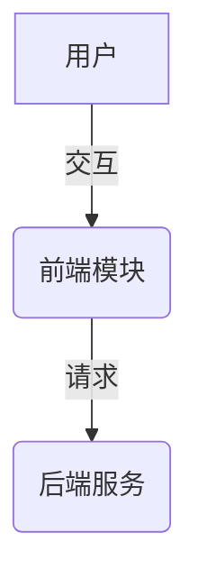

# PRD-[编号]: [项目名称] 产品需求文档 (PRD)

| 属性 | 内容 |
| :--- | :--- |
| **文档编号** | PRD-[编号] |
| **版本** | V1.0 |
| **状态** | Draft (草案) / Proposed (提议) / Implemented (已实现) |
| **作者** | [姓名] |
| **日期** | YYYY-MM-DD |

---

## 1. 项目背景与产品定位
[描述为什么要启动这个项目。它解决了什么具体的痛点？它的产品核心定位是什么？]

### 1.1 背景
*   ...

### 1.2 核心痛点
*   **痛点 1**：...
*   **痛点 2**：...

### 1.3 产品定位
*   ...

---

## 2. 目标用户与使用场景

### 2.1 目标用户
*   **[用户类型 A]**：...
*   **[用户类型 B]**：...

### 2.2 典型使用场景
*   **场景 A**：[描述用户在什么背景下，使用本系统的什么功能，达到什么效果]
*   **场景 B**：...

---

## 3. 系统架构与数据流
[描述系统或功能的高层设计与数据交互逻辑，推荐使用 Mermaid 语法画出流程图或时序图]

---

## 4. 功能需求 (Functional Requirements)

### 4.1 [功能模块 A]
*   **需求描述**：[描述该模块要解决的具体功能需求]
*   **具体要求**：
    *   **要求 1**：...
    *   **要求 2**：...

### 4.2 [功能模块 B]
*   ...

---

## 5. 非功能需求 (Non-Functional Requirements)

### 5.1 安全性与合规性
*   [描述系统在数据传输、敏感信息存储、凭证管理和安全合规等方面的要求]

### 5.2 性能与并发控制
*   [描述响应延迟、最大并发处理、降级控制等要求]

### 5.3 跨平台与兼容性
*   [描述系统应该支持的操作系统、浏览器或依赖客户端的版本限制]

---

## 6. 接口与配置协议说明
[定义本 PRD 所涉及的环境变量配置、对外接口及其输入输出结构]

### 6.1 配置文件/环境变量
*   ...

### 6.2 接口映射表
| 模块/Tool 名称 | 输入参数 | 内部调用 API | 描述 |
| :--- | :--- | :--- | :--- |
| ... | ... | ... | ... |
