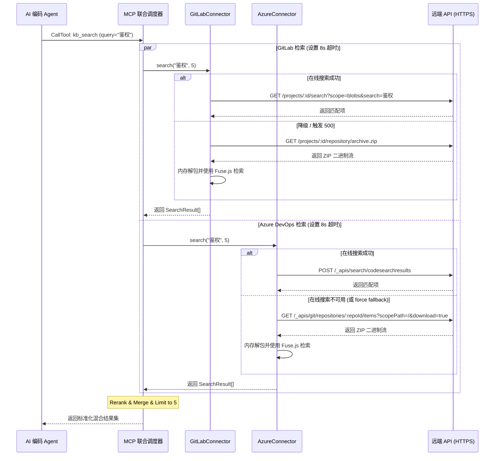

# RFC-002: 多源无盘知识检索系统详细技术设计提案 (RFC)

| 属性 | 内容 |
| :--- | :--- |
| **文档编号** | RFC-002 |
| **关联 PRD** | [PRD-001](../prds/prd-001-multi-source-stateless-mcp.md) |
| **当前状态** | Proposed (已提议) |
| **作者** | Antigravity |
| **日期** | 2026-05-29 |

---

## 1. 摘要 (Summary)
本提案旨在设计并实现一个基于 TypeScript/Node.js 的多源无盘知识检索 Stdio MCP 服务。该服务能够并发地从 GitLab 和 Azure DevOps 检索 Markdown 规范文档，实现多源去重、排序（Rerank），并提供零落盘的按需文件读取与目录感知功能。在远端平台在线检索 API 失效时，支持全内存态下载 ZIP 并使用 Fuse.js 进行模糊检索的降级方案（Fallback Mode）。

## 2. 动机与背景 (Motivation & Background)
随着企业技术规范分布在不同的 GitLab 实例和 Azure DevOps 平台中，AI 编码 Agent 无法通过统一的本地接口对其进行全局感知和安全检索。同时，由于数据合规限制，禁止在研发本地磁盘缓存任何 Wiki 物理 Markdown 文件。
现有系统完全为空，我们需要从零搭建此 Stdio MCP 服务，确保其具备高并发、超时隔离、无盘化、静默降级等特性。

## 3. 详细方案设计 (Detailed Design)

### 3.1 系统/模块交互时序图


### 3.2 接口与类定义

#### 3.2.1 `BaseConnector` 抽象基类
```typescript
export interface SearchResult {
  source: string;          // 数据源 ID (例如 "gitlab_primary")
  repoIdentifier: string;  // 仓库标识 (例如 "12345" 或 "myProj")
  title: string;           // 文件标题/相对路径
  slug: string;            // 路由标识 (例如 "gitlab_primary:docs/api.md")
  preview: string;         // 匹配的文本预览/片段
  score: number;           // 相关性得分
}

export interface TreeItem {
  source: string;
  repoIdentifier: string;
  title: string;
  slug: string;
}

export abstract class BaseConnector {
  public readonly id: string;
  public readonly type: string;
  
  constructor(id: string, type: string) {
    this.id = id;
    this.type = type;
  }
  
  abstract search(query: string, limit: number): Promise<SearchResult[]>;
  abstract read(filePath: string): Promise<string>;
  abstract list(): Promise<TreeItem[]>;
}
```

#### 3.2.2 路由解析机制
对于 `slug` 的解析，为了兼顾多源配置的 `id` 以及 PRD 要求的 `gitlab:<projectId>/<filePath>` 格式，采用多层匹配策略：
1. 尝试匹配 `^([^:]+):(.+)$`。前缀为 `sourceId`，后缀为 `filePath`。
2. 在已加载的 Connector 中，通过 `connector.id === sourceId` 进行匹配。
3. 如果未匹配，再通过 `connector.type === type && connector.projectId/projectName === identifier` 来寻找对应连接器。

### 3.3 内存态 Fallback 降级与缓存机制
当在线搜索失败或配置指定 `fallbackMode: "force"` 时：
1. **下载归档**：使用 `axios`（设置 `responseType: 'arraybuffer'`）获取 `zip`。大小限制在 50MB 以内。
2. **内存解压**：使用 `adm-zip` 的 `new AdmZip(buffer)` 纯内存读取，过滤出 `subDir` 下的 `.md` 文件。
3. **模糊搜索**：使用 `Fuse.js` 创建索引，缓存此索引结构，TTL 设置为 10 分钟。
4. **无落盘**：全过程无任何 `fs.writeFile`。

### 3.4 依赖库变更
*   `@modelcontextprotocol/sdk`: MCP SDK
*   `axios`: HTTP 请求客户端
*   `adm-zip`: 内存 ZIP 解压
*   `fuse.js`: 内存模糊检索
*   `dotenv`: 加载环境变量
*   `typescript`, `esbuild`: 构建与开发

## 4. 替代方案对比 (Alternatives)
*   **方案 A (本地文件同步)**：每次拉取远端文件同步到本地临时目录。
    *   *劣势*：严重违反“零物理文件落地”的安全红线。
*   **方案 B (实时在线 API，无 Fallback)**：完全依赖远端的全文搜索 API。
    *   *劣势*：若企业 GitLab 没配置 Elasticsearch 导致 HTTP 500/403，系统将彻底瘫痪。

## 5. 潜在影响与向下兼容性 (Compatibility & Drawbacks)
*   **向下兼容性**：支持从 `.env` 中读取单源 GitLab 配置，自动转换为单源 Connector 运行，对现有配置完全兼容。
