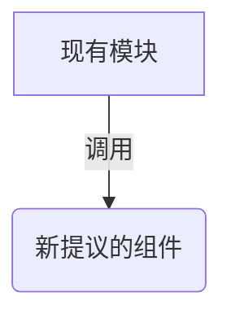

# RFC-001: 团队 RFC 文档结构与编写规范模板

| 属性 | 内容 |
| :--- | :--- |
| **文档编号** | RFC-001 |
| **关联 PRD** | N/A |
| **当前状态** | Draft (草案) / Proposed (已提议) / Accepted (已采纳) |
| **作者** | Antigravity |
| **日期** | 2026-05-28 |

---

## 1. 摘要 (Summary)
[在此处用 2-3 句话简明扼要地总结本技术方案的核心主张，即“我们要改动什么以达到什么效果”。]

## 2. 动机与背景 (Motivation & Background)
[详细阐述为什么要进行这项改动。当前的系统存在什么技术债、性能瓶颈或者需要满足什么新的底层非功能性诉求？]
*   **痛点 1**：...
*   **痛点 2**：...

## 3. 详细方案设计 (Detailed Design)
[这是 RFC 的核心部分。说明具体的技术实现，包括：]
*   **系统/模块交互时序图**（推荐使用 Mermaid 语法）
*   **新的接口 API 协议定义**
*   **依赖库变更** (请确保开源协议商业友好，如 MIT, Apache)
*   **关键算法伪代码或实现伪逻辑**

## 4. 替代方案对比 (Alternatives)
[我们还考虑了哪些方案？为什么最终没有选择它们？请做出客观的优劣势分析：]
*   **方案 A (当前方案)**：
    *   *优势*：无需改动
    *   *劣势*：存在核心痛点
*   **方案 B (替代技术选型)**：
    *   *优势*：...
    *   *劣势*：...

## 5. 潜在影响与向下兼容性 (Compatibility & Drawbacks)
*   **破坏性改动 (Breaking Changes)**：本方案是否会导致现有的 API 接口无法访问，或者需要老旧配置升级？
*   **升级/迁移策略 (Migration Strategy)**：开发人员应该以何种平滑的方式接入本方案。
